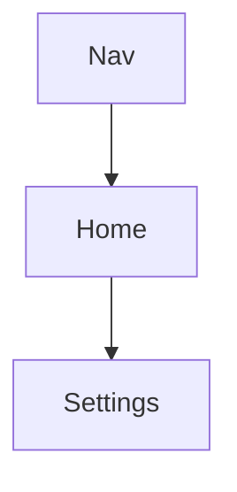

# UX surface map

The checklist of everything a person can see and do in this app: every screen, drill-in, menu, sheet, dialog, popover, Settings row, state, gesture and key, with how it is reached, what is on it, what each control does and the decision behind it. The convention it follows is project-scaffolding's `docs/ux-surface-map.md`.

**Keeping it true.** A change that adds, removes, renames or reshapes a user-visible surface updates this page in the same change, and adds or removes the matching `data-surface` attribute in the code.

**Entry shape.** **`id` Title** · *Root* (`data-surface`, or `none — <reason>`) · *Reach* · *Holds* · *Does* · *States* · *Why*. *Phone* and *Desktop* call out where the two renderings differ.

## Ground rules

Replace with the app's input modes, layout bands, where state lives and what gates features.

## Surface graph

## Chrome

**`chrome.nav` Nav** — *Root:* `data-surface`. *Reach:* always on screen. *Holds:* one tab per destination. *Does:* switches the view. *Why:* the fleet navigation contract.

## Home

**`home.list` Home list** — *Root:* `data-surface`. *Reach:* the Home tab; the first visit lands here. *Holds:* replace. *Does:* replace. *States:* empty: replace.

## Settings

**`settings.sheet` Settings** — *Root:* `data-surface`. *Reach:* the Settings tab. *Holds:* one group per area. *Does:* replace.

## Keys and gestures

**`keys.global` Keyboard shortcuts** — *Root:* none — keys act on the page, not on an element of their own. *Holds:* replace with each key and what it does.

## Where this map was checked

The date of the walk, the build it was made against, and the widths and themes it covered.
